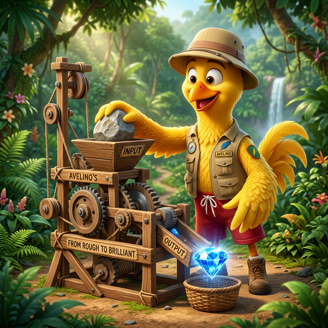
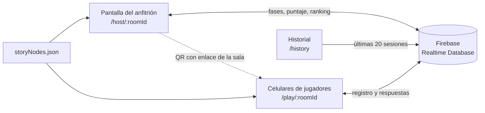

<div align="center">
  
  <h1>AveFlix Live</h1>
  <p><b>Trivia multijugador en tiempo real con historias de decisión para capacitación corporativa</b><br/>Desarrollada para Avellano, empresa avícola colombiana, para capacitar a sus operarios en sesiones presenciales</p>

  
  
  
  
  
  <a href="LICENSE"></a>
</div>

<details>
<summary><b>English summary</b></summary>

AveFlix Live is a real-time multiplayer training trivia (Kahoot style) built for Avellano, a Colombian poultry company, to train plant operators in live sessions. A facilitator projects the host screen, operators join from their phones with a QR code or a PIN, and everyone answers 20 timed decision questions about company culture, occupational health and safety (SST) and the integrated management system (SIG), told as a story with the mascot Avelino. Scores reward correct answers, speed and streaks, and finished sessions are stored in a history view. There is also a single-player story mode. Stack: React 19, TypeScript, Vite 7, Tailwind CSS 4 and Firebase Realtime Database, deployed as a static site.

</details>

## Qué es

Avellano necesitaba reforzar con sus operarios temas de cultura organizacional, seguridad y salud en el trabajo y su sistema integrado de gestión, en sesiones presenciales y con mucha gente al mismo tiempo. AveFlix Live convierte esa capacitación en una partida: el facilitador proyecta la pantalla del anfitrión, cada operario entra desde su celular escaneando un código QR y todos responden las mismas preguntas contra reloj, con un ranking al final.

Las preguntas no son sueltas: forman un recorrido narrativo protagonizado por Avelino, un explorador que enfrenta dilemas en la "selva de los negocios". Cada respuesta incorrecta lleva a una pantalla de retroalimentación que explica por qué, de modo que el error también enseña.

## Funcionalidades

**Modo en vivo (anfitrión y jugadores)**

- Creación de salas con PIN de 6 caracteres; los jugadores entran con un código QR o escribiendo el PIN, y solo registran su nombre.
- Sincronización de fases por Firebase Realtime Database: `LOBBY` → `QUESTION` → `VOTING_RESULTS` → `FEEDBACK_LOOP` → `LEADERBOARD` (más `CANCELED` si el anfitrión cancela).
- 30 segundos por pregunta con temporizador basado en una marca absoluta (`endsAt`), y avance automático a resultados cuando todos los jugadores conectados ya votaron.
- Resultados de votación por opción, retroalimentación de la respuesta correcta y podio final.
- Puntaje por respuesta correcta: 1000 puntos más un bono por velocidad de hasta 500, multiplicado por 1,2 con dos aciertos seguidos y por 1,5 desde tres.
- Detección de desconexión de jugadores (`onDisconnect`), botones para reiniciar o cancelar la sala y limpieza de datos al terminar.
- La partida arranca cuando hay al menos dos jugadores en la sala.
- Historial de sesiones (`/history`) con las últimas 20 partidas y su ranking, filtrable por temporada (mes) y por nombre de jugador.

**Modo individual**

- La pantalla de inicio permite recorrer la historia en solitario, con reintento después de cada error y un resumen de puntaje por pilar al final.

**Contenido**

- `src/data/storyNodes.json`: 42 nodos (inicio, 20 dilemas, 20 nodos de retroalimentación y cierre). Los dilemas se reparten en tres pilares: Cultura (7), SST (3) y SIG (10).
- Una ilustración por pregunta (`public/assets/images/scene_q1.png` a `scene_q20.png`), música de fondo y efectos de sonido con botón de silencio.

## Ilustraciones

<table>
  <tr>
    <td></td>
    <td></td>
    <td></td>
  </tr>
</table>

## Arquitectura



- **Sin backend propio.** Toda la coordinación ocurre en Firebase Realtime Database bajo `rooms/<PIN>` (`meta/phase`, `gameState`, `players`, `responses`, `leaderboard`) y `history`. El anfitrión es quien cambia de fase; los jugadores solo escriben su registro y sus respuestas.
- **El anfitrión calcula el puntaje.** El ranking se deriva en la vista del anfitrión a partir de las respuestas ordenadas por `submittedAt` (para calcular rachas) y se publica en `rooms/<PIN>/leaderboard` para que los celulares lo muestren.
- **Temporizador sin deriva.** Cada pregunta guarda `startedAt` y `endsAt`; los clientes calculan el tiempo restante contra esa marca, lo que evitó condiciones de carrera al cambiar de fase.
- **Contenido como datos.** La historia vive en un JSON; los scripts `generate_nodes.cjs`, `apply_corporate_story.cjs`, `apply_corporate_choices.cjs` y `formalize_texts.cjs` generan y reescriben ese archivo (por ejemplo, para pasar el tono de aventura a uno corporativo).
- **Build optimizado.** Vite separa Firebase, React, React DOM y el generador de QR en chunks propios, y el compilador de React (`babel-plugin-react-compiler`) está activado.

## Stack tecnológico

| Capa | Tecnología |
| --- | --- |
| Interfaz | React 19, TypeScript 5.9, React Router 7 |
| Estilos | Tailwind CSS 4 (`@tailwindcss/vite`) |
| Tiempo real | Firebase 12: Realtime Database (y Analytics) |
| Acceso de jugadores | `react-qr-code` |
| Build y calidad | Vite 7, React Compiler, ESLint 9 |
| Pruebas de carga | Scripts Node (`*.cjs`) contra la API REST de Realtime Database |

## Puesta en marcha

Requisitos: Node.js 20.19 o superior (lo exige Vite 7) y un proyecto de Firebase con Realtime Database.

```bash
npm install
```

Copia `.env.example` a `.env` en la raíz y completa los valores de tu proyecto de Firebase:

| Variable | Obligatoria |
| --- | --- |
| `VITE_FIREBASE_API_KEY` | Sí |
| `VITE_FIREBASE_AUTH_DOMAIN` | Sí |
| `VITE_FIREBASE_DATABASE_URL` | Sí |
| `VITE_FIREBASE_PROJECT_ID` | Sí |
| `VITE_FIREBASE_STORAGE_BUCKET` | Sí |
| `VITE_FIREBASE_MESSAGING_SENDER_ID` | Sí |
| `VITE_FIREBASE_APP_ID` | Sí |
| `VITE_FIREBASE_MEASUREMENT_ID` | No (Analytics) |

Si falta una obligatoria, `src/services/firebase.ts` lanza un error al cargar y la aplicación queda en blanco.

```bash
npm run dev       # servidor de desarrollo
npm run build     # comprobación de tipos y build de producción
npm run preview   # sirve el build localmente
npm run lint      # ESLint
```

Rutas de la aplicación:

| Ruta | Uso |
| --- | --- |
| `/` | Inicio: modo individual, crear sala ("Ser anfitrión"), unirse con PIN, historial |
| `/host/:roomId` | Pantalla proyectada del facilitador |
| `/play/:roomId` | Vista móvil del jugador |
| `/history` | Últimas 20 sesiones |

### Seguridad de Firebase

Las variables `VITE_FIREBASE_*` se incrustan en el JavaScript que descarga el navegador, así que no son secretas: cualquiera puede leerlas en el bundle. La protección real está en las **reglas de seguridad** de Realtime Database. La aplicación no usa autenticación, por lo que antes de usarla con datos reales conviene:

- No dejar la base en modo de prueba (lectura y escritura abiertas).
- Limitar la lectura y escritura a las rutas `rooms` e `history` y validar la forma de cada registro (`.validate`).
- Activar Firebase App Check o autenticación anónima para que solo la aplicación pueda escribir.
- Tener en cuenta que el botón "Limpiar todas las salas" escribe sobre la raíz `rooms`; con reglas estrictas habría que restringirlo a un rol de administrador.

### Pruebas de carga

No hay pruebas automatizadas. Hay scripts para simular jugadores contra una sala abierta usando la API REST de Realtime Database; la URL de la base se pasa en la variable de entorno `FIREBASE_DB_URL`.

| Script | Qué hace |
| --- | --- |
| `node load_test.cjs <PIN>` | 400 jugadores se unen por lotes y votan; mide tiempos y errores |
| `node full_session_test.cjs <PIN>` | 400 bots con distintos perfiles de precisión y velocidad juegan las 20 preguntas |
| `node cleanup_bots.cjs <PIN>` | Elimina los bots y las respuestas de la sala |

## Despliegue

Pensado para un **Static Site** de Render (no hay `render.yaml` en el repositorio):

1. Build command: `npm run build`. Publish directory: `dist`.
2. Definir las variables `VITE_FIREBASE_*` en el panel antes del build, porque Vite las incrusta en ese momento.
3. Añadir una regla de reescritura `/*` → `/index.html` (acción *Rewrite*) para que funcionen las rutas de React Router al recargar `/host/...` o `/play/...`.

Problemas frecuentes:

- **Pantalla en blanco:** falta alguna variable `VITE_FIREBASE_*` o tiene comillas o espacios de más.
- **Error 404 al recargar:** falta la regla de reescritura.
- **Datos que no cargan:** las reglas de Realtime Database están bloqueando el acceso (por ejemplo, porque expiró el modo de prueba).

## Estructura del repositorio

```
src/
  App.tsx                 Rutas e inicio (modo individual, crear sala, unirse)
  views/                  HostView, PlayerView, HistoryView
  components/             Pantallas del modo individual y controles de audio
  context/GameContext.tsx Estado del modo individual
  data/storyNodes.json    Historia: 42 nodos, 20 preguntas
  services/firebase.ts    Inicialización de Firebase desde variables VITE_*
  utils/audioManager.ts   Música y efectos
public/assets/            Ilustraciones y audio
*.cjs                     Generación de contenido y pruebas de carga
```

## Autoría

<table>
  <tr>
    <td align="center"><a href="https://github.com/Joan-Mora"><br/><b>Darwin Joan Aveiga Mora</b></a><br/><sub>Concepto, desarrollo full stack y contenido interactivo</sub></td>
  </tr>
</table>

Desarrollado para Avellano (Colombia).

## Licencia

Copyright © 2026 Darwin Joan Aveiga Mora. **Todos los derechos reservados.**

Este repositorio es público para que el código pueda consultarse como parte de mi portafolio. Eso no concede permiso para copiarlo, reutilizarlo, modificarlo, distribuirlo ni presentarlo como trabajo propio. Los términos completos están en [`LICENSE`](LICENSE). Para cualquier uso, escribe a [darwin@abacore.co](mailto:darwin@abacore.co).

El nombre y la marca Avellano, así como los contenidos de capacitación de la empresa, pertenecen a Avellano.

<div align="center">
<sub>Hecho por <a href="https://github.com/Joan-Mora">Darwin Aveiga</a> · <a href="https://abacore.co">Abacore S.A.S.</a></sub>
</div>
